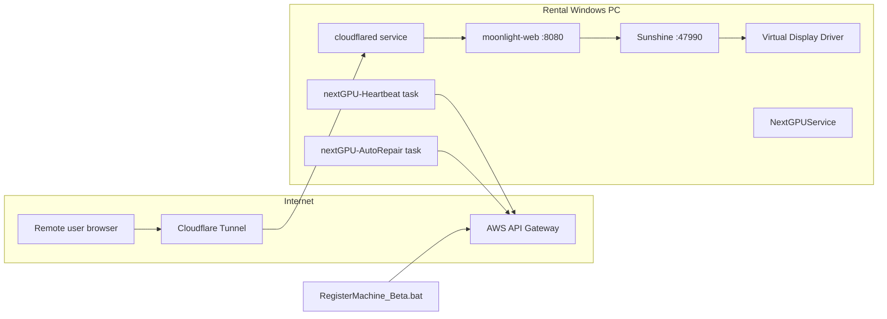

# nextGPU Core Scripts — GPU Rental Machine Setup

Windows automation for provisioning a **remote GPU gaming / rental workstation**: Sunshine streaming host, Moonlight Web client, Cloudflare Tunnel exposure, AWS backend registration, and ongoing health monitoring via Windows services and scheduled tasks.

The **primary entry point** is the root launcher `RegisterMachine_Beta.bat`. Run it once on a fresh machine (as Administrator). It delegates to `scripts/provisioning/RegisterMachine_Beta.bat`, installs drivers, the streaming stack, the tunnel, registers the host, and registers background scheduled tasks.

Related docs:

- [`started.md`](started.md) — fast orientation and script map
- [`setup-beginer.md`](setup-beginer.md) / [`machine-setup-beginer.md`](machine-setup-beginer.md) / [`machine-setup-guide.md`](machine-setup-guide.md) — step-by-step host setup
- [`nextgpu-app/README.md`](nextgpu-app/README.md) — NextGPU controller app and `NextGPUService`
- [`playnitewatcher/README.md`](playnitewatcher/README.md) — PlayNite library and Sunshine app export
- [`session/clean-session.md`](session/clean-session.md) — Clean Session folder rules
- [`user-storage-recreate-flow.md`](user-storage-recreate-flow.md) — per-user `U:` storage after recreating `nextGPU`

---

## Quick start

1. Clone or copy this folder to the target PC (e.g. `Downloads\nextGPU-corescripts`).
2. **Right-click** `RegisterMachine_Beta.bat` → **Run as administrator**
   (The script auto-elevates if needed and reopens an elevated console.)
3. Enter the prompts when asked (see [Required inputs](#required-inputs)).
4. Wait for the full install (downloads, pairing, tunnel creation, API registration).
5. **Reboot manually** when convenient — drivers, display paths, and account renames apply more reliably after restart.

Alternatively, open the NextGPU app (`NextGPU.bat`) and use **Register Machine**; the app writes the form to `logs\register-machine-ui-config.json` and launches setup with `/UiConfig`, so the console prompts are skipped.

### Command-line flags

| Flag | Effect |
|------|--------|
| `/UseVdd` | Install VDD/VAD without asking |
| `/NoVdd` | Skip VDD/VAD (physical-monitor hosts) without asking |
| `/UiConfig` | Read inputs from `logs\register-machine-ui-config.json` (written by the NextGPU app) instead of prompting |

The VDD choice is saved to `machine-profile.json` at the repo root and reused by later scripts (post-Sunshine setup, updates, repair).

---

## Required inputs

During setup, `RegisterMachine_Beta.bat` asks for:

| Prompt | Purpose |
|--------|---------|
| **Install VDD/VAD? [Y/N]** | Whether this host needs the virtual display + audio drivers (skipped when `/UseVdd` or `/NoVdd` is passed) |
| **Cloudflare API Token** | Create/manage tunnels and DNS for `next-gpu.com` |
| **Cloudflare Account ID** | Account that owns the tunnel |
| **API Key** | `x-api-key` header for the register-machine Lambda |
| **Computer Name** | Display name for the rental node (e.g. `GPU-RENTAL-01`); also used in Moonlight `config.json` (lowercased) |
| **Original Price** | Listing price sent to the backend (e.g. `10.99`) |
| **Vendor ID** *(optional)* | If set, sent as `vendor_id` in the `registerMachine` JSON payload and marks the host as a vendor host; press Enter to omit |
| **Change admin username to NextGPU-Authority? [Y/N]** | Some machines cannot rename the local admin; answer **N** to leave it unchanged |
| **Admin account username** | Only asked if you answered **Y** above; the existing local admin to rename → `NextGPU-Authority` |

After entry, a summary is shown; confirm with **Y** to continue or re-enter.

---

## Architecture overview



| Component | Role |
|-----------|------|
| **Sunshine** | GameStream-compatible host; encodes and streams the desktop/games. Runs in the logged-on user session |
| **Moonlight Web** | Browser client + local API on `http://127.0.0.1:8080` |
| **cloudflared** | Cloudflare Tunnel → public HTTPS hostname → local Moonlight |
| **NSSM** | Runs Moonlight Web (and the fallback `gpu-sunshine` service) as Windows services |
| **Task Scheduler** | Runs heartbeat, auto-repair, EndSession, logon helpers, and storage/session tasks |
| **VDD + VAD** | Virtual display and audio so headless/streaming works without a physical monitor (optional per machine) |
| **ViGEmBus** | Virtual gamepad driver for controller input over stream |
| **NextGPU app + NextGPUService** | Operator dashboard and an elevated game-launcher service (built from `apps/NextGPU`) |
| **AWS APIs** | `registerMachine` (one-time) and `updateStatus` (heartbeat / status changes) |

**Static defaults** (inside the batch file):

- Local ingress target: `http://127.0.0.1:8080`
- Public DNS zone: `next-gpu.com`
- Sunshine credentials set during install: `bluefml1` / `letmeinpls`

---

## `RegisterMachine_Beta.bat` — full setup flow

The root launcher delegates to `scripts/provisioning/RegisterMachine_Beta.bat`. The implementation resolves `SCRIPT_DIR` to the repo root (or `NEXTGPU_REPO_ROOT` if set), so generated files, logs, downloads, and service working directories stay at the repo root. Steps below follow execution order.

### Phase 0 — Privileges and configuration

1. **Administrator check** — Uses `fltmc`; if not admin, relaunches via PowerShell `Start-Process ... -Verb RunAs` with marker `__elevated__` (and keeps `/UiConfig` if it was passed).
2. **Configuration** — Either interactive prompts or `/UiConfig` (via `Import-RegisterMachineConfig.ps1`; the UI config file is deleted after it is read). The VDD choice is persisted with `MachineProfile.ps1` → `machine-profile.json`. Computer name is lowercased for Moonlight config substitution (`{{computer_name}}`).
3. **WMI / CIM probe** — Runs `scripts/provisioning/Ensure-WmiSupport.ps1` (log: `logs/wmi-probe.log`). On failure, setup exits. If WMIC is missing, inventory still uses PowerShell CIM.

### Phase 1 — Virtual display and audio (pre-streaming)

4. **VDD + VAD + Virtual Driver Control** *(only when VDD is enabled)* — `scripts/drivers/silent-install-vdd-vad.ps1`
   - Downloads/extracts the official `VDD.Control.{version}.zip` app from VirtualDrivers releases for controller/settings access.
   - Removes existing VDD/VAD devices and driver packages, then installs fresh Virtual Display Driver + Virtual Audio Driver from GitHub driver-only packages.
   - Ensures the official settings folder exists at `C:\VirtualDisplayDriver\` (`vdd_settings.xml` location).
   - Staging: `VDD-VAD-Install\`, log: `logs/VDD-VAD.log`.
   - Setup checks for a ready `DISPLAY\MTT1337*` device and warns (but continues) if none is found.
   - VAD is attempted, but it is non-blocking by default because the upstream VAD can be rejected by Windows Code 52 on some Windows 11 24H2 / Server 2025 images.
   - Waits 10 seconds so the virtual display can enumerate.
5. **RDP recovery** — Always enables Remote Desktop (registry, firewall rule, `TermService`). Confirm RDP works before unplugging all physical monitors.

### Phase 2 — Streaming stack (labeled [1/8]–[4/8] in console)

6. **[1/8] Sunshine**
   - Removes any existing install under `C:\Program Files\Sunshine`.
   - Downloads `sunshine.zip` from [nextGPU-sunshine releases](https://github.com/bluefml1/nextGPU-sunshine/releases/latest) and installs silently (`Sunshine.exe /S`).
   - **Credentials (`:set_sunshine_creds`)** — runs `sunshine.exe --creds bluefml1 letmeinpls`, restarts Sunshine in the user session, and requires `sunshine_state.json` plus HTTP 200 from `https://localhost:47990/api/apps`. If login cannot be established after retries, **setup stops**.
   - **Post-Sunshine setup** — `scripts/provisioning/Invoke-PostSunshineSetup.ps1`:
     1. `Install-SunshineScripts.ps1` — repo `sunshine.conf` → `config/`, `dd_*` settings, support scripts (`endSession.ps1`, `launchGame.ps1`, …) into `C:\Program Files\Sunshine\scripts\`.
     2. `Set-SunshineVddOutput.ps1` *(VDD hosts only)* — resolves the VDD `output_name` with retries (log: `logs/sunshine-vdd-setup.log`).
     3. PlayNite export via `PlayNiteWatcher\Export-SunshineFromPlaynite.ps1` when `PlayNiteWatcher\PlayniteInstall.path` exists. Otherwise it warns to run `PlayNiteWatcher\Setup-PlayniteSteam.bat` later.
   - Credentials are re-applied and re-verified after post-setup.

7. **[2/8] NSSM**
   - Downloads `nssm-2.24.zip` (up to 10 attempts, curl/PowerShell rotation), unless already present.
   - Extracts to `nssm\nssm-2.24\win64\nssm.exe`.

8. **VC++ Runtime** — Checks for 64-bit `System32\vcruntime140.dll`; if missing, installs `vc_redist.x64.exe` (direct download, then `winget` fallback). Moonlight Web needs it.

9. **[3/8] Moonlight Web**
   - Stops/removes the existing `moonlight-web` service if present.
   - Downloads `moonlight-theme.zip` from [nextGPU-moonlight releases](https://github.com/bluefml1/nextGPU-moonlight/releases/latest) → `moonlight-web\`.
   - Downloads `server\config.json` and replaces `{{computer_name}}` with the lowercased custom name.
   - Registers Windows service **`moonlight-web`** via NSSM (auto-start; logs `logs/moonlight-web.log`, `logs/moonlight-web-error.log`).
   - Verifies `http://127.0.0.1:8080/api/serverinfo`; on failure, installs VC++ and restarts the service once.

10. **[4/8] Moonlight ↔ Sunshine pairing**
    - Stops Moonlight, refreshes `server\data.json` from remote template, restarts service.
    - Logs into Moonlight API (`POST /api/login` with test credentials from template), uses pre-configured host ID `0`.
    - Long-poll `POST /api/pair` for a PIN, submits PIN to Sunshine HTTPS API (`https://localhost:47990/api/pin`).
    - Retries up to **100** times; continues on failure with a warning (non-fatal).

11. **ViGEmBus** — `scripts\drivers\ViGEmBus.bat inline` (removes an existing install first). Warning-only on failure; log `logs/ViGEmBus.log`.

### Phase 3 — Cloudflare Tunnel and DNS

12. **[5/8] cloudflared**
    - Downloads `cloudflared.exe` if missing.
    - Verifies API token against Cloudflare.
    - Resolves **Zone ID** for `next-gpu.com`.

13. **[6/8] Network identity**
    - **Public IP:** `https://api.ipify.org` (fallback `127.0.0.1`).
    - **Private IP:** first `192.168.1.*` from `ipconfig`.
    - **DNS_ID:** 8-character uppercase ID from SHA-256(`publicIP,computerName`) mapped to `a-z0-9`.
    - **DOMAIN:** `{DNS_ID}.next-gpu.com`
    - **TUNNEL_NAME:** `{DNS_ID}-tunnel`
    - If tunnel name already exists, appends a random 4-character suffix and rechecks.

14. **[7/8] Tunnel + DNS + service**
    - Creates Cloudflare tunnel via API; configures ingress: hostname → `http://127.0.0.1:8080`, catch-all 404.
    - Deletes conflicting DNS record if any; creates proxied **CNAME** → `{tunnel_id}.cfargotunnel.com`.
    - Removes old `cloudflared` service/registry if present.
    - Sets machine env `CLOUDFLARE_TUNNEL_TOKEN`, runs `cloudflared service install`, starts **`cloudflared`** service.

### Phase 4 — Inventory, registration, and persistence

15. **System inventory** — `Get-MachineInventory.ps1` (CIM): OS, CPU, RAM (GB), GPU name, `LAST_CHECKIN` timestamp.
16. **Benchmarks (optional)** — `Get-BenchmarkScores-Silent.ps1` → `bench_mark_cpu`, `bench_mark_gpu` (default `0` if missing).
17. **Game list for API** — Queries `http://localhost:8080/api/apps?host_id=0&force_refresh=false` and builds JSON map of game title → stream URL (`https://{DOMAIN}/stream.html?hostId=0&appId=...`).
18. **Register machine** — `POST` to
    `https://oa0bwhfkqk.execute-api.ap-southeast-1.amazonaws.com/registerMachine`
    with header `x-api-key: {API_KEY}` and JSON payload (name, IPs, `status: online`, domain, hardware, benchmarks, price, optional `vendor_id`, notes, optional games).
    - Log: `logs/register_api_log.txt`
19. **Identity files**
    - `domain.txt` (repo root, identity only): `DOMAIN`, `PUBLIC_IP`, `COMPUTER_NAME`, `VENDOR_ID`, `VENDOR_ID_ENABLED` (`yes`/`no`). It does **not** hold status.
    - `Invoke-NextGpuMachineIdentity.ps1 -Action SaveIdentity` writes `%ProgramData%\nextGPU\machine-identity.env` and sets `%ProgramData%\nextGPU\machine-status.flag` = `online`.
    - `%ProgramData%\nextGPU\vendor-id.txt` is written for vendor hosts (removed otherwise); EndSession uses it to skip auto-reboot on vendor machines.
20. **Maintenance status** — Sends `status: maintenance` to `updateStatus` so the backend treats the host as in-setup until the end of the script.

### Phase 5 — Sunshine startup, background tasks

21. **Sunshine startup**
    - Installs NSSM service **`gpu-sunshine`** as a **demand-start fallback only** (LocalSystem in session 0 cannot query display paths).
    - `Register-SunshineLogonTask.ps1` registers **`nextGPU-SunshineLogon`**, which starts Sunshine in the user session at logon; `Start-Sunshine-InSession.ps1` starts it now.
    - Waits up to ~2 minutes for the Sunshine API on port 47990.
    - **`:setup_sunshine_device_id`** *(VDD hosts only)* — resolves the VDD device ID (display paths and `sunshine.log`, up to 6 tries with Sunshine reset/restart), writes `dd_configuration_option = ensure_only_display` and `dd_config_revert_on_disconnect = enabled` into `sunshine.conf`, and restarts Sunshine. It does **not** write `output_name`. If it fails, it is retried at the end of setup. Log: `logs/sunshine-bind.log`.

22. **Legacy service cleanup** — Removes old NSSM services `gpu-heartbeat`, `auto-repair`, and `auto-update` if present. Heartbeat and repair now run from Task Scheduler.

23. **[8/8] Scheduled tasks** — `scripts/tasks/TaskScheduler.ps1` runs:

    | Script | Task | Trigger |
    |--------|------|---------|
    | `Register-HeartbeatTask.ps1` | `nextGPU-Heartbeat` | At boot + every 5 minutes (SYSTEM) |
    | `Register-AutoRepairTask.ps1` | `nextGPU-AutoRepair` | At boot + every 1 minute (SYSTEM) |
    | `Register-NvidiaLogonTask.ps1` | `nextGPU-NvidiaLogon` | At user logon — starts NVIDIA app in session |
    | `Register-EndSessionTask.ps1` | `EndSession` | Application log event `LogoffManager` ID 2002 → `C:\Program Files\Sunshine\scripts\endSession.ps1` |
    | `Register-NextGpuEndSessionRecoveryTask.ps1` | `nextGPU-EndSessionRecoveryStartup` | At startup — finishes interrupted EndSession profile resets, then publishes `online` |
    | `launchGameTaskScheduler.ps1` | `auto game launch` | At user logon → Sunshine `launchGame.ps1` (falls back to repo `sunshine\launchGame.ps1` or `Z:\launchGame.ps1`) |
    | `PlayNiteWatcher\Register-PlayniteLogonTask.ps1` | `nextGPU-PlayniteLogon` | At logon (only if PlayNite setup exists) |

    It also removes the deprecated `nextGPU-AutoUpdate` task. Heartbeat/auto-repair tasks run their `.bat` through `Invoke-ScheduledRuntimeBat.ps1`, which appends output to `logs/<name>.log` / `logs/<name>-error.log`.

### Phase 6 — Wallpaper, accounts, and finish

24. **Wallpaper** — `scripts/desktop/Setup-Wallpaper.bat inline` → `Set-DesktopWallpaper-Gpo.ps1` (Fit desktop, lock/sign-in), then `Register-WallpaperFitLogonTask.ps1` (**`nextGPU-WallpaperFitLogon`**) and `Release-DefaultUserHives.ps1`. Runs **before** account changes.
25. **Rename admin** *(optional)* — Renames `{ADMIN_ACCOUNT_NAME}` → **`NextGPU-Authority`** (username + full name). Skipped if you answered **N**.
26. **Rental user**
    - `Ensure-NextGpuRestrictedGroup.ps1 -CreateGroupOnly` creates the **`NextGPURestricted`** group.
    - `net user nextGPU /add` creates the standard rental user, then `Ensure-NextGpuRestrictedGroup.ps1` applies group membership/restrictions.
    - `Register-NextGpuDesktopCleanupTask.ps1` registers **`nextGPU-DesktopCleanupLogon`**: at every **nextGPU** logon, `Clear-NextGpuUserDesktop.ps1` removes all items from that user's Desktop folder (also run once now). Does **not** clear `C:\Users\Public\Desktop`.
    - `Register-SessionFolderRulesTasks.ps1` registers the Clean Session tasks (`nextGPU-SessionFolderRulesLogoff` / `nextGPU-SessionFolderRulesLogon`). See [`session/clean-session.md`](session/clean-session.md).
    - If user storage was already set up (`%ProgramData%\nextGPU\rclone\rclone.conf` exists), `Sync-NextGpuUserStorageForLocalUser.ps1` re-binds storage tasks/ACLs for the new account.
    - `Repair-NextGpuAdminCredAcl.ps1` refreshes the deny ACL on `admincred.dat` for `nextGPU`.
27. **Shutdown lock** — `Setup-Shutdown-Policy.bat inline` / `Set-ShutdownPolicy.ps1`: only **`NextGPU-Authority`** may shut down or restart; `nextGPU` and all other users are blocked (user rights + Start menu policy + logon task).
28. **Deferred display binding** — Retries `:setup_sunshine_device_id` if it failed earlier.
29. **Online status** — Sends `status: online` to `updateStatus`.
30. **NextGPU controller build** — If the .NET 8 SDK is installed, runs `apps\NextGPU\build-publish.bat` (builds `NextGPU.exe` and installs/starts **`NextGPUService`**). Otherwise prints instructions.
31. **Completion message** — Prompts for **manual reboot** (drivers, display paths, accounts).

---

## Wallpaper only (standalone)

Run as Administrator from the repo root:

```bat
scripts\desktop\Setup-Wallpaper.bat
```

Requires `assets\nextgputobu.jpeg` in the repo. After setup, verify on the GPU PC:

```powershell
powershell -ExecutionPolicy Bypass -File scripts\desktop\Test-WallpaperPolicy.ps1
```

Look for **`[OK] WallpaperStyle = 6`**, desktop path pointing to **`nextgputobu-4k.bmp`** or **4K JPEG**, and **no** `WallpaperStyle = 10` (Fill/crop). After success, open **Local Group Policy Editor** → **User Configuration** → **Administrative Templates** → **Desktop** → **Desktop** → **Desktop Wallpaper** — it should show **Enabled**, path `C:\Users\Public\Wallpaper\nextgputobu.jpeg`, style **Fit**. **Desktop** uses a fixed **3840×2160** master (`nextgputobu-4k.bmp`, or your **4K JPEG** directly if it is already 3840×2160) with **Fit** (`Policies\System` = `3`, `Control Panel\Desktop` = `6`) so the **full** image shows on 1080p/1440p/4K rentals. **Lock/sign-in** keeps **`nextgputobu.jpeg`**. **`nextGPU-WallpaperFitLogon`** re-applies on logon. Setup hides icons and clears Public Desktop shortcuts. (**Computer Configuration** → same desktop wallpaper policy stays *Not Configured*; Desktop Wallpaper is a user policy only.)

## Shutdown lock only (standalone)

Restrict shut down and restart to **NextGPU-Authority** only (`nextGPU` and other users blocked):

```bat
scripts\desktop\Setup-Shutdown-Policy.bat
```

---

## Ongoing operations (after setup)

### Machine status

Status lives in `%ProgramData%\nextGPU\machine-status.flag` (managed by `scripts/runtime/Invoke-NextGpuMachineIdentity.ps1`), not in `domain.txt`. Valid values:

| Status | Set by | Meaning |
|--------|--------|---------|
| `online` | Setup, checking-update, auto-repair, startup recovery | Healthy and rentable |
| `updating` | `checking-update.bat` | Update in progress; auto-repair skips |
| `update_fail` | `checking-update.bat` | Update failed; auto-repair repairs without changing status |
| `error` | `auto-repair.bat` | A health check failed; repair in progress |

Two extra ProgramData flags pause the heartbeat: `heartbeat-suspended.flag` and `startup-publish-pending.flag` (used during vendor shutdown / startup publish).

### Heartbeat (`scripts/runtime/heartbeat-only.bat` → task `nextGPU-Heartbeat`)

Runs **once per trigger** (at boot and every **5 minutes**, as SYSTEM):

1. Exits early if `heartbeat-suspended.flag` or `startup-publish-pending.flag` exists.
2. Reads `domain.txt` (`PUBLIC_IP`, `COMPUTER_NAME`) and the status from `machine-status.flag` (default `online`).
3. Refreshes private IP (`192.168.1.*`).
4. `POST` to `https://oa0bwhfkqk.execute-api.ap-southeast-1.amazonaws.com/updateStatus` with JSON: computer name, public/private IP, status.

Logs: `logs/heartbeat.log`, `logs/heartbeat-error.log`. To change the interval, edit `-Interval` in `scripts/tasks/Register-HeartbeatTask.ps1` and re-run it as Administrator.

### Auto-repair (`scripts/runtime/auto-repair.bat` → task `nextGPU-AutoRepair`)

Runs **once per trigger** (at boot and every **1 minute**, as SYSTEM), after network is reachable. Skips entirely when `machine-status.flag` is `updating`.

| Check | Action if failed |
|-------|------------------|
| `cloudflared` service running | `net start cloudflared` only — never triggers a streaming-stack reinstall |
| `sunshine.exe` process | Start in user session (`Start-Sunshine-InSession.ps1` / `nextGPU-SunshineLogon`); full repair if still down or missing |
| `moonlight-web` service | `net start`; full repair if it stays down |
| `http://127.0.0.1:8080` returns 200 | Full repair |
| Sunshine credentials + Moonlight pairing (`Test-StreamingCredentials.ps1`) | `Restore-SunshineCredentials.ps1` and/or re-pair only (`Run-StreamingStackUpdate.bat Skip Skip ForcePairing`) |

**Full repair** runs `scripts/runtime/Run-StreamingStackUpdate.bat ForceReinstall ForceReinstall ForcePairing` → `Update-NextGpuStreamingStack.ps1`.

**Status reporting:** on the first failed check it sets the flag to `error` and sends `error` to `updateStatus` (not re-sent if already `error`), repairs, then sends `online`. If the flag is `update_fail`, it repairs without changing status; after a successful repair, vendor hosts (`VENDOR_ID_ENABLED=yes`) call only the `onDemandGPUHost` shutdown API (`Invoke-VendorOfflineShutdown.ps1`) and other hosts send `online`. If `checking-update` switches the flag to `updating` mid-run, auto-repair stops without touching status. If cloudflared cannot be restarted, the status is left as is.

Logs: `logs/auto-repair.log`, `logs/auto-repair-error.log`.

### Update check (`scripts/runtime/checking-update.bat`)

Run once (EndSession / vendor path, or manually). Logs to `logs/checking-update.log`.

1. Repairs/reads `domain.txt`, sets status `updating` (flag + `updateStatus`).
2. Runs `Run-StreamingStackUpdate.bat CheckUpdate CheckUpdate` (update Sunshine/Moonlight only when versions differ, re-pair after update).
3. Result:
   - Success, non-vendor host → `online`.
   - Success, vendor host → calls `onDemandGPUHost` shutdown and leaves status `updating` (cleared at next boot by `nextGPU-EndSessionRecoveryStartup`).
   - Failure → `update_fail` (no shutdown call).

### Shared streaming stack (`Update-NextGpuStreamingStack.ps1`)

`checking-update.bat` and `auto-repair.bat` do not duplicate Sunshine/Moonlight logic. They call `scripts/runtime/Run-StreamingStackUpdate.bat`, which invokes `scripts/provisioning/Update-NextGpuStreamingStack.ps1`.

| Caller | Sunshine mode | Moonlight mode | Pairing |
|--------|---------------|----------------|---------|
| `checking-update.bat` | `CheckUpdate` | `CheckUpdate` | After update only |
| `auto-repair.bat` (full repair) | `ForceReinstall` | `ForceReinstall` | Always (`ForcePairing`) |
| `auto-repair.bat` (pairing/creds only) | `Skip` | `Skip` | Always (`ForcePairing`) |

After Sunshine install/reinstall, the stack runs `Invoke-PostSunshineSetup.ps1` (same as setup):

1. `Install-SunshineScripts.ps1` — repo `sunshine.conf` → `config/`, `dd_*` settings, support scripts
2. `Set-SunshineVddOutput.ps1` *(VDD hosts only, per `machine-profile.json`)* — up to 6 retries with Sunshine restart; resolves VDD `device_id` from display paths and/or `sunshine.log` (log wins when present); writes `output_name` to `sunshine.conf` (logs to `logs/sunshine-vdd-setup.log`; WARN only if not resolved)
3. PlayNite export when `PlayNiteWatcher\PlayniteInstall.path` exists (use `-RefreshPlayniteLibrary` after installing new games on disk)

`RegisterMachine_Beta.bat` `:setup_sunshine_device_id` is separate (writes `dd_*` only; does not set `output_name` automatically).

### Other maintenance scripts (not run by main setup)

| Script | Purpose |
|--------|---------|
| `NextGPU.bat` (repo root) | Opens the NextGPU operator dashboard (builds it first if needed) |
| `Start-Sunshine.bat` (repo root) | Starts Sunshine in the current user session |
| `scripts/maintenance/updateGames.bat` | Restarts Sunshine, reads Moonlight apps, sends stream URLs to AWS `updateNewGame` (`/UseDomainTxt` for no prompts) |
| `scripts/maintenance/sync-games-apps-official.bat` / `push-games-apps-to-r2.bat` | Download / upload official game & app archives on Cloudflare R2 via rclone |
| `scripts/maintenance/arrange-games-apps.bat` | Arrange synced games/apps into Steam, Garena, LevelUp, and HoYoPlay layouts |
| `scripts/maintenance/Install-*Client.ps1` | Install Steam, Garena, LevelUp, or HoYoPlay clients |
| `scripts/maintenance/Install-GarenaPlatformService.ps1` / `Register-GarenaLaunchCompanion.ps1` | Garena platform service and `gxxapphelper.exe` launch companion for `NextGPUService` |
| `scripts/maintenance/Create-Z-Partition.ps1` | Shrink a volume and create/extend the `Z:` partition |
| `scripts/maintenance/Run-ChkDsk-Repair.ps1` | Run `chkdsk /f` on one or all fixed drives, then prompt for reboot |
| `scripts/maintenance/Test-NextGpuLayout.ps1` | Quick layout/helper checks before setup or uninstall |
| `scripts/maintenance/copy.bat` / `extract.bat` / `garena.bat` | Image-specific game/app deployment |
| `scripts/runtime/User-Storage.bat` | Per-user S3 storage: Setup, Test, Mount, Sync, Troubleshoot, Logs |
| `scripts/runtime/Update-NextGPUService.ps1` / `Test-NextGPUService.ps1` | Replace or smoke-test the installed `NextGPUService` |
| `scripts/drivers/InstallVDD-VAD.bat` | Standalone VDD+VAD installer wrapper |
| `PlayNiteWatcher/Setup-PlayniteSteam.bat` | PlayNite + Steam setup and Sunshine app export (see [`playnitewatcher/`](playnitewatcher/README.md)) |

---

## Windows services created

| Service name | Executable / command | Start type |
|--------------|----------------------|------------|
| `moonlight-web` | `moonlight-web\web-server.exe` (NSSM) | Auto |
| `cloudflared` | `cloudflared.exe` (tunnel token) | Auto |
| `gpu-sunshine` | `C:\Program Files\Sunshine\sunshine.exe` (NSSM, LocalSystem) | Manual (fallback only) |
| `NextGPUService` | `C:\Program Files\NextGPU\Service\NextGPUService.exe` | Auto (installed by `apps\NextGPU\build-publish.bat`) |

Sunshine normally runs in the **logged-on user session** (scheduled task `nextGPU-SunshineLogon` + `Start-Sunshine-InSession.ps1`). Running Sunshine as `LocalSystem` in session 0 causes `ERROR_ACCESS_DENIED` when querying display paths (empty `[]` device list) even when VDD is installed. After VDD install, **reboot**, then **RDP or console logon** once so Sunshine can see the virtual display.

Heartbeat and auto-repair are **scheduled tasks**, not services (`nextGPU-Heartbeat`, `nextGPU-AutoRepair`). Older hosts may still have the legacy `gpu-heartbeat` / `auto-repair` NSSM services; re-running setup removes them.

## Scheduled tasks created

| Task | Purpose |
|------|---------|
| `nextGPU-Heartbeat` | `heartbeat-only.bat` every 5 min |
| `nextGPU-AutoRepair` | `auto-repair.bat` every 1 min |
| `nextGPU-SunshineLogon` | Start Sunshine in the user session at logon |
| `nextGPU-NvidiaLogon` | Start NVIDIA app at logon |
| `EndSession` | Run Sunshine `endSession.ps1` on `LogoffManager` event 2002 |
| `nextGPU-EndSessionRecoveryStartup` | Finish interrupted EndSession resets and publish `online` at boot |
| `auto game launch` | Run `launchGame.ps1` at logon |
| `nextGPU-PlayniteLogon` | PlayNite at logon (if configured) |
| `nextGPU-WallpaperFitLogon` | Re-apply Fit wallpaper at logon |
| `nextGPU-DesktopCleanupLogon` | Clear the `nextGPU` Desktop at logon |
| `nextGPU-SessionFolderRulesLogoff` / `nextGPU-SessionFolderRulesLogon` | Clean Session folder rules |
| `nextGPU-UserStorageEnsureBindings` / `nextGPU-UserStorageMount` / `nextGPU-UserStorageUnmount` | Per-user `U:` storage (only after `User-Storage.bat Setup`) |

To re-register the core tasks, run `scripts\tasks\TaskScheduler.ps1` as Administrator. `scripts\tasks\Test-TaskSchedulerSetup.ps1` checks them.

---

## Key files and logs

```
nextGPU-corescripts/
├── RegisterMachine_Beta.bat      # Main setup launcher
├── NextGPU.bat                   # NextGPU operator dashboard launcher
├── Start-Sunshine.bat            # Start Sunshine in the current session
├── uninstall-all.bat             # Root uninstall launcher
├── apps/NextGPU/                 # NextGPU app + NextGPUService sources, build-publish.bat
├── config/                       # Defaults (launch companions, session folder rules template)
├── templates/session/            # Clean Session template notes
├── PlayNiteWatcher/              # PlayNite setup + Sunshine app export
├── scripts/
│   ├── provisioning/             # Main setup, Sunshine/VDD helpers, inventory
│   ├── runtime/                  # Heartbeat, repair, update, user storage, session rules
│   ├── drivers/                  # VDD/VAD + ViGEmBus installers
│   ├── desktop/                  # Wallpaper, shutdown policy, desktop cleanup
│   ├── tasks/                    # Scheduled task registration
│   └── maintenance/              # Games/apps sync + layout, clients, disk, uninstall
├── docs/                         # Documentation
├── assets/
│   └── nextgputobu.jpeg          # Wallpaper source
├── domain.txt                    # Created at end of setup (identity; required for heartbeat)
├── machine-profile.json          # Per-machine settings (VDD enabled/disabled)
├── logs/                         # Generated repo logs
│   ├── register_api_log.txt
│   ├── setup_log_YYYYMMDD.txt
│   ├── wmi-probe.log
│   ├── VDD-VAD.log
│   ├── ViGEmBus.log
│   ├── sunshine-bind.log
│   ├── sunshine-vdd-setup.log
│   ├── moonlight-web.log / moonlight-web-error.log
│   ├── heartbeat.log / heartbeat-error.log
│   ├── auto-repair.log / auto-repair-error.log
│   ├── checking-update.log
│   └── uninstall-nextgpu.log
├── moonlight-web/                # Downloaded at setup
├── nssm/                         # NSSM binaries
├── sunshine/                     # Extracted installer + support scripts
└── cloudflared.exe               # Downloaded if missing
```

Machine-wide state lives in `%ProgramData%\nextGPU\` (`machine-identity.env`, `machine-status.flag`, `vendor-id.txt`, `repo-root.txt`, heartbeat flags, `logs\`, `rclone\`, `secrets\`, session rules).

---

## External dependencies (downloaded at runtime)

| Asset | Source |
|-------|--------|
| Sunshine | `github.com/bluefml1/nextGPU-sunshine` (latest `sunshine.zip`) |
| Moonlight Web | `github.com/bluefml1/nextGPU-moonlight` (latest `moonlight-theme.zip`) |
| Moonlight `config.json` / `data.json` | `github.com/Nguyenanvu202/bongsenvang-config` / `bongsenvang-data` |
| NSSM | `github.com/Nguyenanvu202/NssmService` |
| cloudflared | Cloudflare releases (windows-amd64) |
| VDD/VAD/NefCon | GitHub (via `silent-install-vdd-vad.ps1`) |
| VC++ Redistributable x64 | `aka.ms/vs/17/release/vc_redist.x64.exe` (winget fallback) |
| .NET 8 SDK | Installed by `NextGPU.bat` if missing (only needed to build the NextGPU app) |

Requires **curl** (or PowerShell fallback), **PowerShell 5.1+**, and outbound HTTPS.

---

## Per-user S3 storage (opt-in)

After setup, an administrator can enable tenant personal storage for the **nextGPU** rental account:

1. Install credentials: machine env `NEXTGPU_USER_S3_ACCESS_KEY` / `NEXTGPU_USER_S3_SECRET_KEY`, or `%ProgramData%\nextGPU\secrets\user-s3.env` (see `scripts/runtime/user-s3.env.example`).
2. Run `scripts\runtime\User-Storage.bat Setup` (or `Setup-UserStorage.bat`) **once** (installs WinFsp/rclone if needed, writes `%ProgramData%\nextGPU\rclone\rclone.conf`, registers logon/logoff tasks). Recreating the `nextGPU` user does not require setup again — `nextGPU-UserStorageEnsureBindings` re-binds at boot and nextGPU logon; `User-Storage.bat Sync` fixes it manually.
3. On **nextGPU** logon, `Mount-UserStorage.ps1` reads `domain.txt`, calls `checkDomain`, and mounts `nextgpu-user:{userID}/` as **`U:`** with a `{lastName}'s Storage` label. On logoff, `Unmount-UserStorage.ps1` stops rclone and clears state.

This is separate from R2 games sync (`Sync-GamesApps-Official.ps1`). Uninstall removes `nextGPU-UserStorage*` tasks and ProgramData rclone/secrets paths. Details: [`user-storage-recreate-flow.md`](user-storage-recreate-flow.md).

---

## Security notes

- Setup prompts for **secrets in the console** (Cloudflare token, API key). Do not commit real tokens; rotate if logs are shared.
- **User S3 keys** for `nextgpu-user` rclone and **onDemandGPUHost** secrets (`ondemand-gpu-host.env`) must not be committed; use env or `%ProgramData%\nextGPU\secrets\` only.
- Default Sunshine and Moonlight test credentials are embedded for automated pairing — change for production hardening if needed.
- Tunnel token is stored in the **machine** environment variable `CLOUDFLARE_TUNNEL_TOKEN`.
- If you choose to rename it, the former admin account becomes **`NextGPU-Authority`**; a separate **`nextGPU`** user (in group `NextGPURestricted`) is created for rental sessions.

---

## Troubleshooting

| Symptom | What to check |
|---------|----------------|
| Setup exits at WMI step | `logs/wmi-probe.log`, run `scripts/provisioning/Ensure-WmiSupport.ps1` manually |
| Setup stops with "Sunshine bluefml1 login" error | `C:\Program Files\Sunshine\config\sunshine_state.json` exists? `https://localhost:47990/api/apps` returns 200 with `bluefml1` / `letmeinpls`? |
| Moonlight Web not responding after install | `logs/moonlight-web-error.log`; usually missing x64 `vcruntime140.dll` — install `vc_redist.x64.exe` and restart `moonlight-web` |
| No virtual display in Sunshine | Inspect `logs\VDD-VAD.log`, `logs\sunshine-bind.log`, `logs\sunshine-vdd-setup.log`; reboot, RDP logon, then run `Get-DisplayDeviceId.ps1 -ListAll -IncludeInactive` |
| Pairing warnings | Sunshine running? Firewall on 47990? Auto-repair re-pairs automatically when pairing material is missing |
| Heartbeat errors | `domain.txt` exists? Task `nextGPU-Heartbeat` exists and ran (`schtasks /Query /TN nextGPU-Heartbeat /V`)? No `heartbeat-suspended.flag` left in `%ProgramData%\nextGPU`? Check `logs/heartbeat.log`. |
| Auto-repair keeps reinstalling | `logs/auto-repair.log`, local HTTP on 8080, and whether `machine-status.flag` is stuck at `updating` |
| Public URL not loading | `sc query cloudflared`, tunnel DNS in Cloudflare dashboard |
| Registration failed | `logs/register_api_log.txt`, API key, payload size (games JSON) |

---

## Technologies

- **Sunshine** — Game streaming host
- **Moonlight Web** — Browser streaming client
- **Cloudflare Tunnel (`cloudflared`)** — HTTPS without opening inbound ports
- **NSSM** — Non-interactive Windows services from executables
- **Windows Task Scheduler** — Heartbeat, auto-repair, logon/logoff helpers
- **AWS API Gateway** — `registerMachine` / `updateStatus` / `updateNewGame`
- **PowerShell CIM** — Hardware inventory without deprecated `wmic`
- **ViGEmBus** — Virtual Xbox/controller driver
- **.NET 8** — NextGPU app and `NextGPUService`
